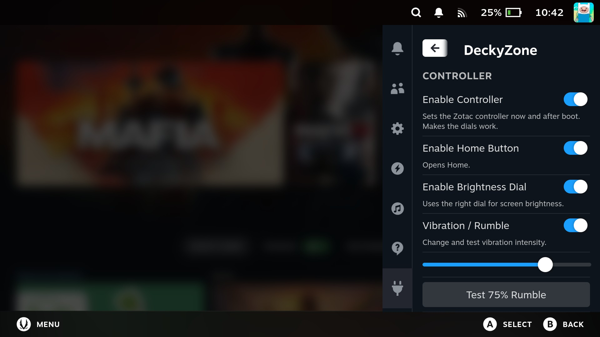

# DeckyZone

[](https://github.com/DeckFilter/DeckyZone/releases)
[](https://github.com/DeckFilter/DeckyZone/releases/latest)

DeckyZone is a Decky Loader plugin for the Zotac Gaming Zone. It adds custom controller mappings, display fixes and hardware settings.



## Features

- Global and per-game dial and trackpad mappings, plus a configurable Home button.
- Custom rumble strength and per-game Xbox controller simulation.
- Zotac controller artwork and hiding unsupported Steam Input controls.
- Zotac OLED display profile and green tint compensation.
- SteamOS battery time estimate fix.
- VRAM size selection (4–8 GB).
- Native Steam performance profiles and an 8–30 W TDP slider (SteamOS).
- Global CPU boost toggle through SteamOS Manager.
- Global fan control: System Auto, Manual or Curve, with PowerControl curve import.

## Installation

Install [Decky Loader](https://github.com/SteamDeckHomebrew/decky-loader#-installation) first, then run this command in a terminal in Desktop Mode:

```bash
curl -L https://raw.githubusercontent.com/DeckFilter/DeckyZone/main/install.sh | sh
```

Check for updates in **General > Software Updates**, or read the [release notes](https://github.com/DeckFilter/DeckyZone/releases). **Update Channel**, under **Beta Participation**, defaults to **Stable**. Choose **Pre-release** to try preview builds. Switching back offers the stable version and keeps saved settings.

## Performance profiles

Enable **Performance > Native Performance Controls** in DeckyZone to add these profiles to Steam's Performance menu:

| Profile     | Power limit            |
| ----------- | ---------------------- |
| Low Power   | 8 W                    |
| Balanced    | 15 W                   |
| Performance | 28 W                   |
| Custom      | 8–30 W (20 W default)   |

## Compatibility and troubleshooting

I test and develop DeckyZone on SteamOS. Bazzite and CachyOS compatibility is based on user reports.

Controller features require InputPlumber and drivers for the ZONE's input devices.

Disable PowerControl and SimpleDeckyTDP in Decky settings before using native controls, CPU boost or Manual/Curve fan mode.

- The battery time estimate fix is available only on SteamOS.
- Green Tint Compensation may not correct green tint at low brightness.

If controller input stops responding, try **Troubleshooting > Reapply Controller Profile**. It reloads the controller configuration without deleting saved settings.

SteamOS users can update InputPlumber from **Troubleshooting**. The update remains installed after DeckyZone is reset or removed; use **Restore SteamOS InputPlumber** to undo it. SteamOS updates may reset this override. Bazzite and CachyOS use their distribution's packages.

## Support

[Open an issue](https://github.com/DeckFilter/DeckyZone/issues) to report a bug or request a feature, or join [Discord](https://discord.gg/dyMMQNKdMH) for discussion.

## Donations

DeckyZone is free. You can support development through:

[GitHub Sponsors](https://github.com/sponsors/DeckFilter) · [Patreon](https://www.patreon.com/DeckFilter) · [Ko-fi](https://ko-fi.com/deckfilter) · [Buy Me a Coffee](https://www.buymeacoffee.com/deckfilter)

## Credits and references

The following projects provided code references, artwork and inspiration for DeckyZone:

- [Handheld Controller Glyphs](https://github.com/victor-borges/handheld-controller-glyphs)
- [CSS Loader](https://github.com/DeckThemes/SDH-CssLoader)
- [Legion Go Remapper](https://github.com/aarron-lee/LegionGoRemapper)
- [HueSync](https://github.com/honjow/HueSync)
- [PowerControl](https://github.com/mengmeet/PowerControl)
- [DeckyPlumber](https://github.com/aarron-lee/DeckyPlumber)
- [OpenZone](https://github.com/OpenZotacZone/ZotacZone-Drivers)

The fan editor is adapted from PowerControl under its BSD 3-Clause license. Copyright and license details are in LICENSE. For RGB lighting, use HueSync.
